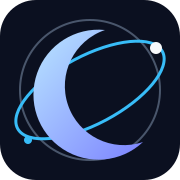

<a href="docs/og-banner.svg">Social preview artwork</a>

> **An open-source, self-hosted control plane for applications, containers, databases, and servers.**
>
> **Your Infrastructure. Your Rules.**

MOONSHIPS brings applications, containers, Docker Compose stacks, databases, domains, TLS, backups, and server operations into one lightweight control plane—from a small VPS to a fleet of servers.

MOONSHIPS is a separately branded derivative of the Pier codebase. Upstream copyright and license notices are retained. The archived `UPSTREAM-PIER-*` documents are historical upstream legal references; they are not MOONSHIPS contributor agreements or MOONSHIPS trademark policy.

## MW Universe OS — the canonical ecosystem repository

This repository is the single long-term working home for the wider MW ecosystem. MOONSHIPS remains the infrastructure operations product identity; **MW** is the canonical repository and ecosystem workspace.

The ecosystem is being consolidated as a modular monorepo: one source of truth, explicit domain ownership, shared platform foundations, and multiple bounded product experiences. **ARSY is the designated highest technical control plane** for identity, trust, governance, system awareness, policy, and orchestration. Domain products retain their specialized responsibilities and must not create competing authorities.

The consolidation is being tracked in:
- [MW Universe OS Target Architecture](docs/MW_UNIVERSE_OS_BLUEPRINT.md)
- [Ecosystem Consolidation TODO](docs/ECOSYSTEM_CONSOLIDATION_TODO.md)
- [Ecosystem Consolidation Audit](docs/ECOSYSTEM_CONSOLIDATION_AUDIT.md)
- [BRIDGE-ALLAH organization repository audit (2026-11-09)](docs/ECOSYSTEM_ORG_REPOSITORY_AUDIT_2026-11-09.md)
- [MW architecture conflict register](docs/MW_ARCHITECTURE_CONFLICT_REGISTER.md)
- [ARSY Fastify source audit](docs/ARSY_MOONWITNESS_FASTIFY_SOURCE_AUDIT.md)
- [RGBL, MFTL, MOONSKY and MOONSHIPS domain audit](docs/DOMAIN_SOURCE_AUDIT_RGBL_MFTL_MOONSKY_MOONSHIPS.md)
- [Deep source audit: platform, ARSY, gateway, data and UI](docs/DEEP_SOURCE_AUDIT_PLATFORM_ARSY_GATEWAY_DATA_UI_2026-11-09.md)
- [Federation security review: TLS, WebSocket credentials, RBAC and SSRF](docs/FEDERATION_SECURITY_REVIEW_2026-11-09.md)
- [Ecosystem Repository Register](docs/ECOSYSTEM_REPOSITORY_REGISTER.md)
- [Complete public bjo163 repository index](docs/ECOSYSTEM_PUBLIC_REPOSITORY_INDEX.md)

These documents distinguish verified implementation from prototypes, plans, legacy sources, and unresolved candidates. No legacy repository is considered migrated or safe to archive merely because it appears in the register.

## What you can do
- **Deploy applications:** Git-based deployments, Dockerfiles, images, Compose, and Railpack auto-builds.
- **Operate containers:** lifecycle, logs, stats, networks, and images.
- **Manage infrastructure:** domains, reverse proxy, automatic TLS, multi-server agents, and WireGuard mesh.
- **Run data services:** PostgreSQL, MySQL/MariaDB, MongoDB, Redis/Valkey, and more.
- **Protect your work:** scheduled backups, S3 integration, deployment history, rollback, and audit logs.
- **Work from one dashboard:** responsive web UI, role-based access, authentication, and database tools.

## Installation

### Build and install from source
Requirements: Linux, Docker Engine, Docker Compose plugin, Git, curl, and Rust 1.93+.

    git clone https://github.com/BRIDGE-ALLAH/MW.git
    cd MW
    cargo build --release --package pier-core
    sudo bash scripts/install.sh --binary target/release/pier

The executable and systemd identifiers remain Pier-named for compatibility with existing nodes. This is intentional; the public product identity is MOONSHIPS.

### Release installer
The one-command release flow requires a MOONSHIPS GitHub Release with compatible binary and checksum assets. Until those assets are published, use the source installation above. Never bypass checksum verification.

After installation, open https://YOUR_SERVER_IP:8443/setup and create the administrator account.

## Existing Pier server migration

**Upgrade in place; do not uninstall Pier first and do not delete /opt/pier.** Build the MOONSHIPS-compatible binary and run the installer over the existing installation. The compatibility layer retains:
- /opt/pier/data and /opt/pier/.env
- SQLite database and application metadata
- pier system user/group and Docker group membership
- pier.service, pier-net-helper.service, updater units, and /run/pier/net.sock
- Docker networks, containers, volumes, TLS material, and application data

The installer automatically backs up the existing data directory, environment, binaries, and systemd units under `/var/backups/moonships/` before replacement. Also take a provider snapshot (Docker volumes are outside that backup) and verify a backup before upgrading. See [MIGRATION.md](MIGRATION.md).

**Do not rename legacy data paths, service units, accounts, environment keys, or helper sockets during a branding-only upgrade.** The current runtime components depend on these interfaces; changing them independently risks downtime or data loss.

## Requirements
- Basic Docker/Compose workloads: 1 vCPU and 512 MB RAM minimum (more recommended).
- Railpack builds: 4 GB RAM and 40+ GB free disk recommended.
- Linux with systemd for the native installer.

## Brand identity

MOONSHIPS follows the **Space Punk / Underground Future** direction: Grunge texture, Riot conviction, Funky energy, and Gen-Z cultural fluency. The canonical rules and design tokens live in [Brand Book v1](docs/BRAND-BOOK.md) and [brand-tokens.json](branding/brand-tokens.json).

## Project and license
This repository retains compatibility identifiers from the Pier codebase during migration. Existing copyright notices, license files, and applicable upstream attribution are preserved. Review [LICENSE](LICENSE) and comply with AGPL-3.0 when redistributing modified builds.

## Contributing
Issues and pull requests are welcome. Include reproduction steps, expected behavior, and logs with secrets removed.
